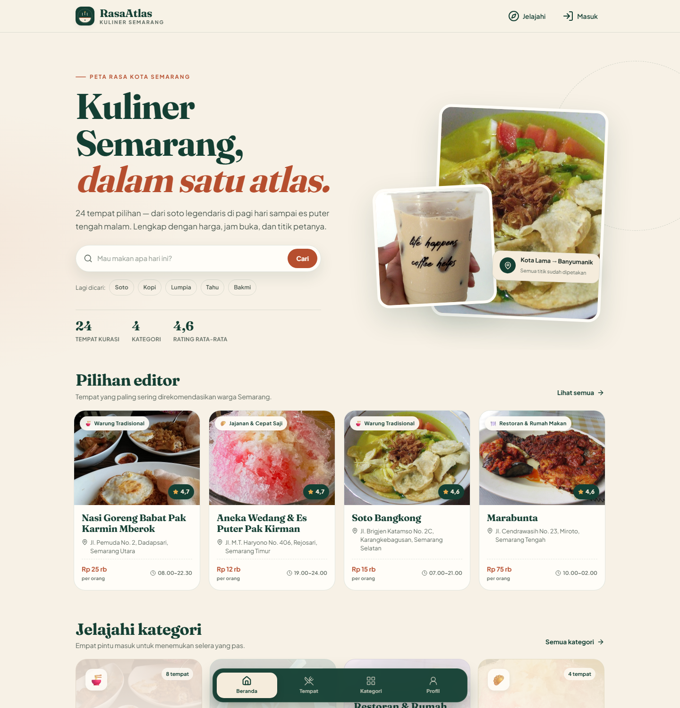
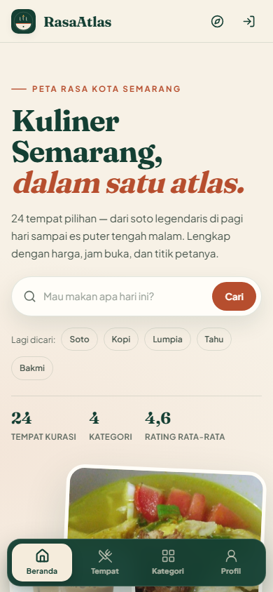
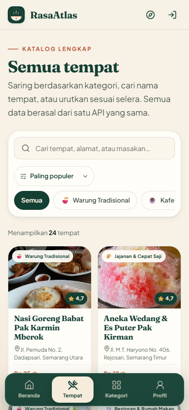
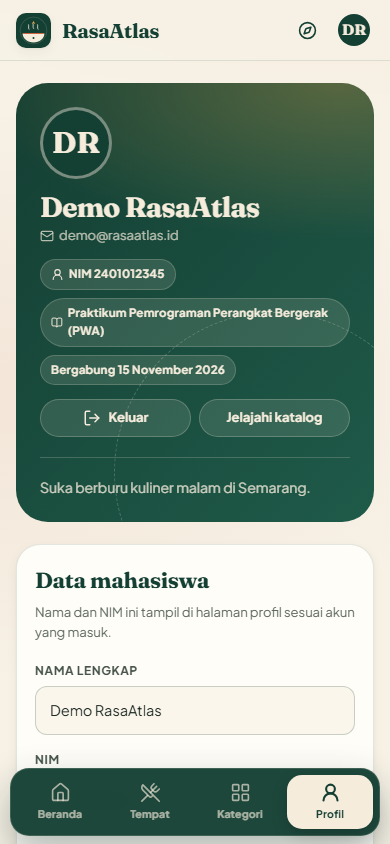

# RasaAtlas 🍜☕

**Katalog kuliner Semarang dalam bentuk Progressive Web App.**
24 tempat pilihan — warung legendaris, kafe, restoran, dan jajanan — lengkap dengan
harga, rating, jam buka, deskripsi, dan titik peta. Bisa dipasang di layar utama dan
tetap terbuka saat offline.



---

## ✨ Fitur

- **Backend REST API sendiri** (Express + SQLite) dengan data 24 tempat & 4 kategori.
- **Autentikasi** daftar/masuk (JWT + bcrypt). Halaman profil menampilkan nama, NIM,
  dan mata kuliah sesuai akun yang sedang masuk.
- **6 halaman utama**: Beranda, List Tempat, Detail Tempat, List Kategori,
  Detail Kategori, Profil/About — ditambah halaman Masuk, Daftar, dan 404.
- **Pencarian & filter** berdasarkan kata kunci, kategori, dan urutan (rating, harga, nama).
- **Peta Leaflet** di halaman detail + tautan rute ke Google Maps.
- **PWA**: manifest, ikon 192/512/maskable, service worker (Workbox), install prompt,
  dan halaman yang tetap bisa dibuka offline.
- **Status loading / error / data kosong** di semua halaman, dengan retry.
- **Bottom navigation** fixed, aman untuk safe-area iPhone.
- Responsif: 1 kolom di ponsel, grid di desktop; mendukung `prefers-reduced-motion`.

### Tangkapan layar

| Beranda (ponsel) | Daftar tempat (ponsel) | Profil (ponsel) |
| --- | --- | --- |
|  |  |  |

Semua tangkapan layar ada di [`docs/screenshots/`](docs/screenshots/) (desktop 1440px
dan ponsel 390px), termasuk halaman detail, kategori, masuk, dan daftar.

---

## 🧱 Teknologi

| Lapisan | Teknologi |
| --- | --- |
| Frontend | React 19, React Router 7, Vite 8, Leaflet, lucide-react |
| PWA | vite-plugin-pwa 2 (Workbox), Web App Manifest |
| Backend | Node.js 20+, Express 5, better-sqlite3, JWT, bcryptjs |
| Database | SQLite (file `backend/data/rasaatlas.db`) |
| Data awal | OpenStreetMap / Overpass API + kurasi manual |
| Foto | Wikimedia Commons (lihat `docs/CREDITS-FOTO.md`) |

---

## 📁 Struktur repositori

```
rasaatlas/
├── backend/                 API Express + SQLite
│   ├── data/seed.json       sumber data 24 tempat & 4 kategori
│   ├── src/
│   │   ├── app.js           konfigurasi Express + CORS + error handler
│   │   ├── index.js         entry point server
│   │   ├── db.js            skema & koneksi SQLite
│   │   ├── seed.js          impor data awal
│   │   ├── mappers.js       normalisasi field (default "Tidak diketahui")
│   │   ├── routes/          tempat.js, kategori.js, auth.js
│   │   └── middleware/      requireAuth (JWT)
│   └── package.json
├── frontend/                React + Vite + PWA
│   ├── public/images/       24 foto tempat + placeholder
│   ├── src/
│   │   ├── pages/           Beranda, TempatList, TempatDetail, KategoriList,
│   │   │                    KategoriDetail, Profil, Login, Register, NotFound
│   │   ├── components/      Layout, BottomNav, TempatCard, LeafletMap, dll.
│   │   ├── context/         AuthContext
│   │   ├── hooks/           useApi, useOnline, useInstallPrompt, useDebouncedValue
│   │   └── lib/             klien fetch API + formatter
│   ├── scripts/             unduh foto & generate ikon
│   └── vite.config.js       manifest + service worker
├── scripts/                 query Overpass & data mentah OSM
├── docs/                    kredit foto, panduan deploy, screenshot
├── render.yaml              blueprint deploy API ke Render
└── README.md
```

---

## 🚀 Menjalankan di lokal

Prasyarat: **Node.js 20.19+** (disarankan 24), npm, Git.

### 1. Backend

```bash
cd backend
npm install
cp .env.example .env        # Windows: copy .env.example .env
npm run seed                # membuat database + mengisi 24 tempat
npm run dev                 # http://localhost:4000
```

Cek cepat: buka <http://localhost:4000/health> → `{"status":"ok","tempat":24,...}`.

`.env` backend:

```env
PORT=4000
CORS_ORIGIN=http://localhost:5173,http://localhost:4173
JWT_SECRET=ganti-dengan-string-acak-yang-panjang
DB_PATH=./data/rasaatlas.db
```

### 2. Frontend

```bash
cd frontend
npm install
cp .env.example .env        # isi VITE_API_BASE_URL=http://localhost:4000
npm run dev                 # http://localhost:5173
```

Build produksi & pratinjau:

```bash
npm run build
npm run preview             # http://localhost:4173 (service worker aktif)
```

### 3. Akun demo

| Email | Password |
| --- | --- |
| `demo@rasaatlas.id` | `demo12345` |

Bisa juga mendaftar akun baru di `/daftar`; nama + NIM akan muncul di halaman Profil.

---

## 🔌 Endpoint API

Base URL lokal: `http://localhost:4000`

| Method | Endpoint | Keterangan |
| --- | --- | --- |
| GET | `/health` | Status server & jumlah tempat |
| GET | `/tempat` | Daftar tempat (bisa difilter) |
| GET | `/tempat/:id` | Detail tempat berdasarkan **id** atau **slug** + 3 tempat terkait |
| GET | `/kategori` | Semua kategori + jumlah tempat + foto sampel |
| GET | `/kategori/:id/tempat` | Tempat dalam kategori (id atau slug) |
| GET | `/kategori/:id` | Detail satu kategori |
| POST | `/auth/register` | Daftar akun baru → `{ token, user }` |
| POST | `/auth/login` | Masuk → `{ token, user }` |
| GET | `/auth/me` | Profil akun aktif (Bearer token) |
| PUT | `/auth/me` | Ubah nama, NIM, bio (Bearer token) |

### Query parameter `GET /tempat`

| Parameter | Contoh | Keterangan |
| --- | --- | --- |
| `q` | `soto` | Cari di nama, alamat, deskripsi |
| `kategori` | `tradisional` | Slug atau id kategori |
| `populer` | `1` | Hanya tempat unggulan |
| `min_rating` | `4.5` | Rating minimum |
| `max_harga` | `30000` | Harga maksimum |
| `sort` | `rating` | `populer`, `rating`, `harga`, `harga_desc`, `nama`, `terbaru` |
| `limit` | `24` | 1–100 (default 50) |
| `offset` | `0` | Untuk paginasi |

Contoh:

```bash
curl "http://localhost:4000/tempat?kategori=kafe&sort=rating&limit=5"
curl "http://localhost:4000/tempat/soto-bangkong"
curl "http://localhost:4000/kategori/tradisional/tempat"

curl -X POST http://localhost:4000/auth/login \
  -H "Content-Type: application/json" \
  -d '{"email":"demo@rasaatlas.id","password":"demo12345"}'
```

Respons daftar selalu berbentuk:

```json
{ "data": [ ... ], "meta": { "total": 8, "limit": 50, "offset": 0 } }
```

Semua field kosong sudah dinormalisasi menjadi `"Tidak diketahui"` (atau `null` untuk
koordinat), sehingga UI tidak pernah menampilkan `undefined`.

Koleksi Postman siap impor: **`docs/RasaAtlas.postman_collection.json`**.

---

## 🗄️ Skema database

```sql
kategori (id, slug, nama, ikon, deskripsi)

tempat   (id, slug, nama, kategori_id → kategori.id, alamat, harga, rating,
          deskripsi, foto_url, lat, lng, jam_buka, populer, osm_id, created_at)

users    (id, nama, email UNIQUE, password_hash, nim, bio, created_at)
```

Seed ulang:

```bash
cd backend
npm run seed          # idempoten (upsert)
npm run seed:reset    # hapus lalu isi ulang; akun pengguna juga dihapus
```

---

## 🌐 Deploy

Ringkasan (detail langkah ada di **[docs/DEPLOY.md](docs/DEPLOY.md)**):

1. **API → Render** — gunakan `render.yaml`, set `JWT_SECRET` (generate) dan
   `CORS_ORIGIN` ke domain Vercel. Database SQLite otomatis di-seed saat pertama jalan.
2. **Frontend → Vercel** — root directory `frontend`, tambahkan environment
   `VITE_API_BASE_URL=https://<api-kamu>.onrender.com`, lalu deploy. `vercel.json`
   sudah menangani SPA rewrite, cache aset, dan header service worker.
3. **Urutan penting:** deploy API dulu → deploy frontend → salin domain frontend ke
   `CORS_ORIGIN` API → redeploy API bila perlu.
4. **Verifikasi:** buka DevTools → Application → Manifest & Service Workers, lalu
   jalankan Lighthouse (mode Navigation, kategori PWA) dan coba “Install app”.

Alternatif: Netlify/GitHub Pages untuk frontend (sama-sama HTTPS) dan Railway/Fly.io
untuk API. Yang wajib: **HTTPS** dan CORS yang mengizinkan domain frontend.

> Catatan: Render free memakai disk sementara. Setiap redeploy/restart, file SQLite
> kembali kosong lalu di-seed otomatis (data 24 tempat aman, akun yang dibuat setelahnya
> akan hilang). Untuk data pengguna permanen, tambahkan Render Disk (berbayar) dan set
> `DB_PATH=/var/data/rasaatlas.db`, atau migrasikan ke Postgres/MySQL.

---

## 📱 Checklist PWA

- [x] `manifest.webmanifest` — nama, `short_name`, ikon 192 & 512 (plus maskable),
      `theme_color`, `background_color`, `display: standalone`, `start_url`.
- [x] Service worker via `vite-plugin-pwa` — precache app shell, `NetworkFirst` untuk
      API, `CacheFirst` untuk gambar & tile peta.
- [x] Offline: halaman yang sudah dikunjungi tetap terbuka; banner “Mode offline”.
- [x] Install prompt + petunjuk iOS.
- [x] HTTPS saat deploy (Vercel/Render).
- [x] Bottom navigation `position: fixed` + safe-area.
- [x] Loading, error, dan empty state di setiap halaman.

### Menguji offline

1. `npm run build && npm run preview`
2. Buka beranda dan satu detail tempat.
3. DevTools → Network → **Offline** → refresh. Data yang sudah di-cache tetap tampil,
   dan banner offline muncul.

### Lighthouse

```bash
npx lighthouse http://localhost:4173 --view --preset=desktop
```

Target: kategori **PWA** hijau (installable, service worker aktif, HTTPS/`localhost`).
Skor dapat berbeda di akun Vercel karena header cache; lihat `docs/DEPLOY.md`.

---

## 🗺️ Asal data

1. Query Overpass API untuk `amenity=restaurant|cafe|fast_food` di bounding box
   Semarang (lihat `scripts/fetch-osm.mjs`, hasil di `scripts/raw-osm.json`).
2. 24 tempat dipilih dari 369 hasil berdasarkan kelengkapan tag (alamat, telepon,
   jam buka, koordinat) dan keterwakilan kategori.
3. Field yang tidak tersedia di OSM (harga, rating, deskripsi, foto) diisi manual
   sebagai data kurasi pembelajaran. Rating bersifat ilustratif, bukan hasil survei.
4. Foto adalah **ilustrasi hidangan** dari Wikimedia Commons, bukan foto lokasi.
   Atribusi lengkap: **`docs/CREDITS-FOTO.md`**. Data peta © kontributor OpenStreetMap
   (ODbL).

---

## ✅ Status pengerjaan

| Tahap | Status |
| --- | --- |
| 1. Persiapan (judul, repo, tooling) | ✅ struktur repo siap; tinggal push ke GitHub |
| 2. Data (Overpass, 24 tempat, CSV/JSON) | ✅ `scripts/raw-osm.json` + `backend/data/seed.json` |
| 3. Backend (Express, SQLite, endpoint, CORS, deploy) | ✅ kode & uji lokal; deploy mengikuti `docs/DEPLOY.md` |
| 4. Frontend PWA (React, router, 6 halaman, Leaflet) | ✅ termasuk login/daftar |
| 5. Fitur PWA (manifest, service worker, HTTPS, Lighthouse) | ✅ siap; jalankan Lighthouse setelah deploy |
| 6. Penyelesaian (profil, README, push, demo) | ✅ profil per akun + README; screenshot di `docs/screenshots/` |

---

## 📄 Lisensi

Kode proyek: MIT (lihat `LICENSE`). Data OpenStreetMap: ODbL. Foto: lisensi
masing-masing seperti tercantum di `docs/CREDITS-FOTO.md`.
